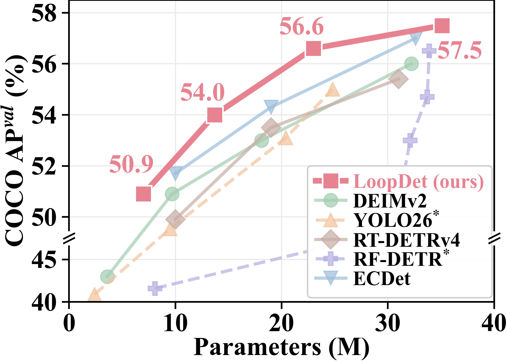
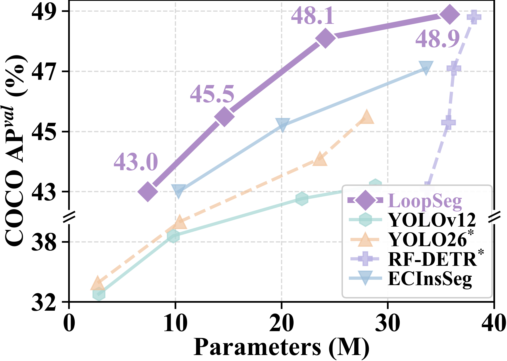
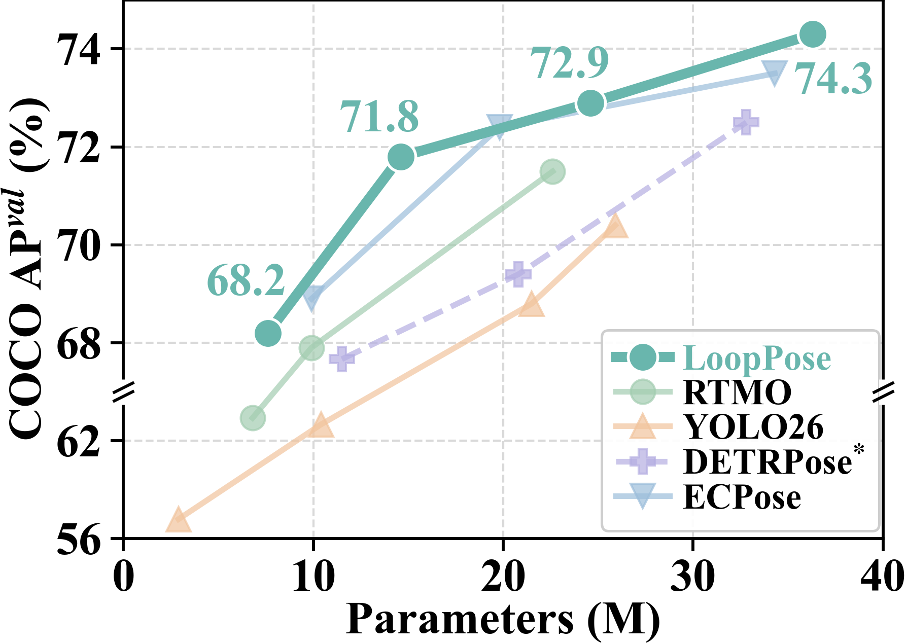
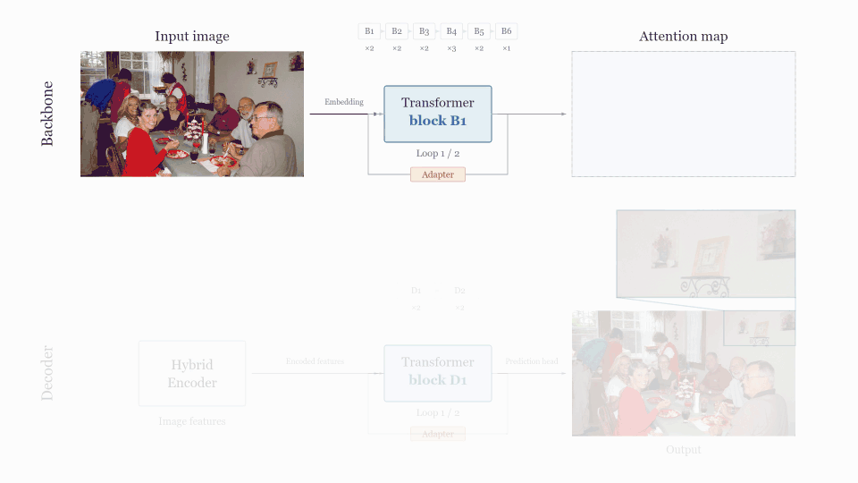

<div align="center">


<h2 >Looped Transformer for Efficient Dense Visual Recognition</h2>

<p>
  <a href=""></a>
  <a href=""></a>
</p>

#### Sirui Liang<sup>1,2</sup> · [Xuanlong Yu<sup>2</sup>](https://xuanlong-yu.github.io/) · [Longfei Liu<sup>2</sup>](https://capsule2077.github.io/) · [Xiaodong Cun<sup>1,📪</sup>](https://vinthony.github.io/academic/) · [Xi Shen<sup>2</sup>](https://xishen0220.github.io/)

<sup>1</sup> [GVC Lab](https://gvclab.github.io/), [Great Bay University](https://www.gbu.edu.cn/) &nbsp;&nbsp; <sup>2</sup> [Intellindust AI Lab](https://github.com/Intellindust-AI-Lab)

<p align="center">
  
  
  
</p>
</div>

## 📋 TODO
- [ ] If you find LoopDVR useful or interesting, please give us a Star🌟! Your support drives us to keep improving.
- [ ] Fix bugs (If you encounter any issues, please feel free to open an issue or contact me! 🙏)
- [ ] 🔥 Release `paper`!
- [ ] 🔥 Release `inference code` and `pretrained weights`!

## ⚙️ Method

### Overview


### Looped Inference



## 🏆 Model Zoo

### COCO val2017 results

> Latency and peak memory are measured on an NVIDIA RTX 4090 D with batch size 1 and resolution 640 × 640 under FP16 using PyTorch (v2.11.0+cu128). 

### Object Detection

| Model | Params (M) | Peak mem. (MiB) | GFLOPs | Latency (ms) | AP | Checkpoint |
| --- | :---: | :---: | :---: | :---: | :---: | :---: |
| LoopDet-S | 7.0 | 15.9 | 53.0 | 1.62 | 50.9 | [model](https://github.com/Siruuui/LoopDVR_Weights/releases/download/v1.0/loopdet-s.pth) |
| LoopDet-M | 13.9 | 29.1 | 90.3 | 2.03 | 54.0 | [model](https://github.com/Siruuui/LoopDVR_Weights/releases/download/v1.0/loopdet-m.pth) |
| LoopDet-L | 23.4 | 47.3 | 158.9 | 2.82 | 56.6 | [model](https://github.com/Siruuui/LoopDVR_Weights/releases/download/v1.0/loopdet-l.pth) |
| LoopDet-X | 35.1 | 69.8 | 216.2 | 3.33 | 57.5 | [model](https://github.com/Siruuui/LoopDVR_Weights/releases/download/v1.0/loopdet-x.pth) |

### Instance Segmentation

| Model | Params (M) | Peak mem. (MiB) | GFLOPs | **Latency (ms)** | AP | Checkpoint |
| --- | :---: | :---: | :---: | :---: | :---: | :---: |
| LoopSeg-S | 7.4 | 16.7 | 60.0 | 1.72 | 43.0 | [model](https://github.com/Siruuui/LoopDVR_Weights/releases/download/v1.0/loopseg-s.pth) |
| LoopSeg-M | 14.6 | 30.5 | 101.4 | 2.18 | 45.5 | [model](https://github.com/Siruuui/LoopDVR_Weights/releases/download/v1.0/loopseg-m.pth) |
| LoopSeg-L | 24.1 | 48.7 | 170.0 | 2.98 | 48.1 | [model](https://github.com/Siruuui/LoopDVR_Weights/releases/download/v1.0/loopseg-l.pth) |
| LoopSeg-X | 35.8 | 71.2 | 227.3 | 3.47 | 48.9 | [model](https://github.com/Siruuui/LoopDVR_Weights/releases/download/v1.0/loopseg-x.pth) |

### Human Pose Estimation

| Model | Params (M) | Peak mem. (MiB) | GFLOPs | **Latency (ms)** | AP | Checkpoint |
| --- | :---: | :---: | :---: | :---: | :---: | :---: |
| LoopPose-S | 7.7 | 26.3 | 58.1 | 2.98 | 68.2 | [model](https://github.com/Siruuui/LoopDVR_Weights/releases/download/v1.0/looppose-s.pth) |
| LoopPose-M | 14.6 | 39.5 | 98.3 | 3.24 | 71.8 | [model](https://github.com/Siruuui/LoopDVR_Weights/releases/download/v1.0/looppose-m.pth) |
| LoopPose-L | 24.6 | 58.7 | 169.1 | 3.98 | 72.9 | [model](https://github.com/Siruuui/LoopDVR_Weights/releases/download/v1.0/looppose-l.pth) |
| LoopPose-X | 36.3 | 82.0 | 229.7 | 4.46 | 74.3 | [model](https://github.com/Siruuui/LoopDVR_Weights/releases/download/v1.0/looppose-x.pth) |


## 🚀 Getting Started

### 📦 Installation

```bash
# clone this repo
git clone https://github.com/Intellindust-AI-Lab/LoopDVR
cd LoopDVR

# Create conda environment
conda create -n loopdvr python=3.11 -y
conda activate loopdvr

# Install dependencies
pip install -r requirements.txt
```

### ⏬ Download weights

**Option 1**: Download all model weights automatically:

```bash
python tools/download_weights.py
```

**Option 2**: Download the model weights you need from any of the following sources and place them in `./weights` folder:
    
<a href="https://pan.baidu.com/s/1kjcOW_Fp0X0SXRn3J6eB3Q?pwd=2026"></a>
<a href="https://drive.google.com/drive/folders/12ukTmcUXBlJJcVdsdeeZLPke1TqxEMEd"></a>
<a href="https://github.com/Siruuui/LoopDVR_Weights/releases/tag/v1.0"></a>


### ⚡ Inference

Place the matching checkpoint in `weights/`. For example, `weights/loopdet-s.pth` goes with `configs/loopdet/loopdet-s.yaml`. To run LoopDet-S on a local image named `example.jpg`:

```bash
python tools/infer.py \
    --config configs/loopdet/loopdet-s.yaml \
    --weights weights/loopdet-s.pth \
    --input example.jpg \
    --output outputs/boxes.png
```

Use `--device cpu` for CPU inference. The `--threshold` option controls the
display score threshold (default 0.4).


<details>
<summary><b>📊 Evaluation</b></summary>

Set `COCO_ROOT` to COCO 2017 directory containing `val2017/` and `annotations/`.
Detection and segmentation use `instances_val2017.json`. Pose uses
`person_keypoints_val2017.json`.

```bash
python tools/eval_coco.py \
    --config configs/loopdet/loopdet-s.yaml \
    --weights weights/loopdet-s.pth \
    --coco-root "$COCO_ROOT" \
    --output outputs/bbox.json
```

Evaluation runs in FP32, using batch size 4 by default.
`--batch-size` and `--workers` to adjust evaluation settings. 

</details>

## 👀 Visualization Results


<p align="center"><b>LoopSeg</b></p>
<video src="https://github.com/user-attachments/assets/abe1631e-599e-40d0-b5d9-0748f829917b" controls="controls" width="100%"></video>

<p align="center"><b>LoopPose</b></p>
<video src="https://github.com/user-attachments/assets/43bbb06b-6943-4379-9c7d-4c8a837eaac9" controls="controls" width="100%"></video>


## ❤️ Acknowledgements

We thank the authors of the following open-source projects that made this work possible: [EdgeCrafter](https://github.com/Intellindust-AI-Lab/EdgeCrafter), [RF-DETR](https://github.com/roboflow/rf-detr),  [Raptor](https://github.com/KempnerInstitute/raptor), and [SReT](https://github.com/szq0214/sret).

## 📚 Citation

If you find this project useful in your research, please consider citing:

```bibtex

```